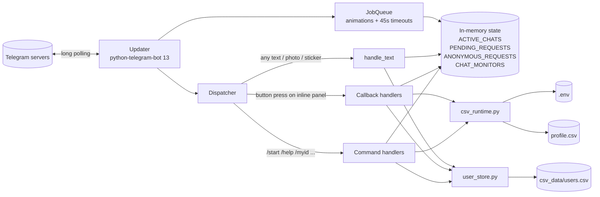
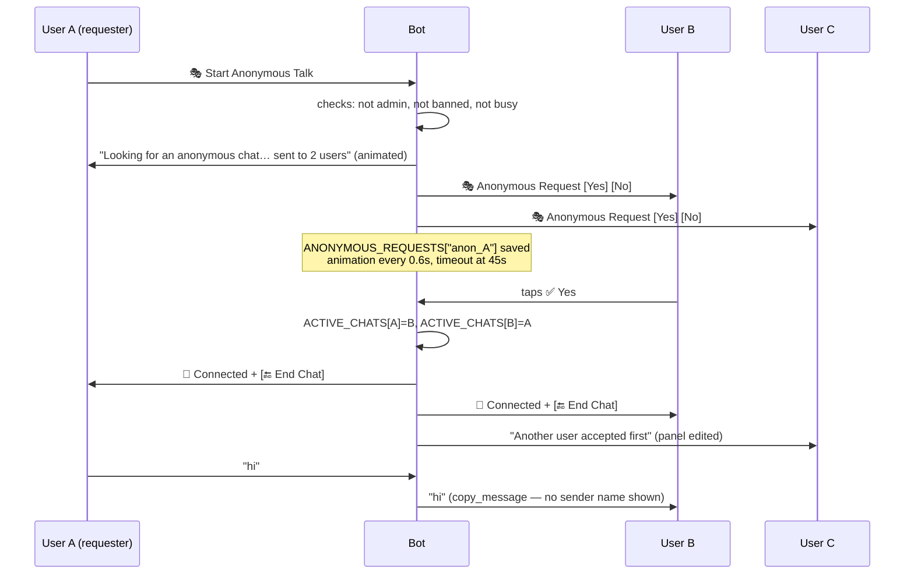
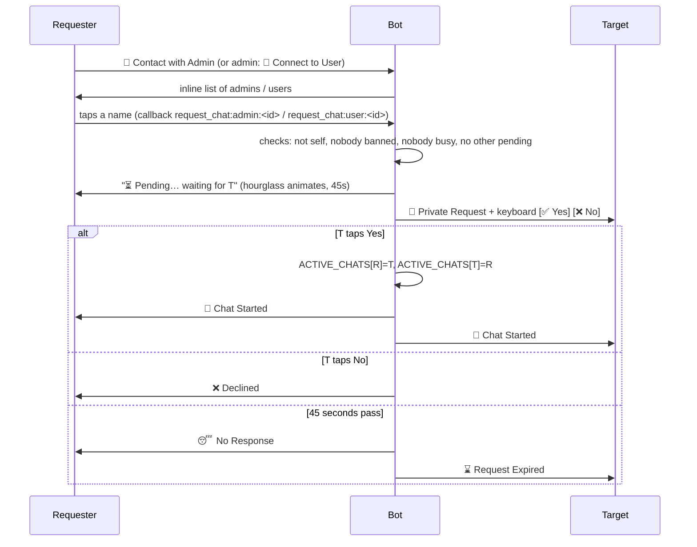
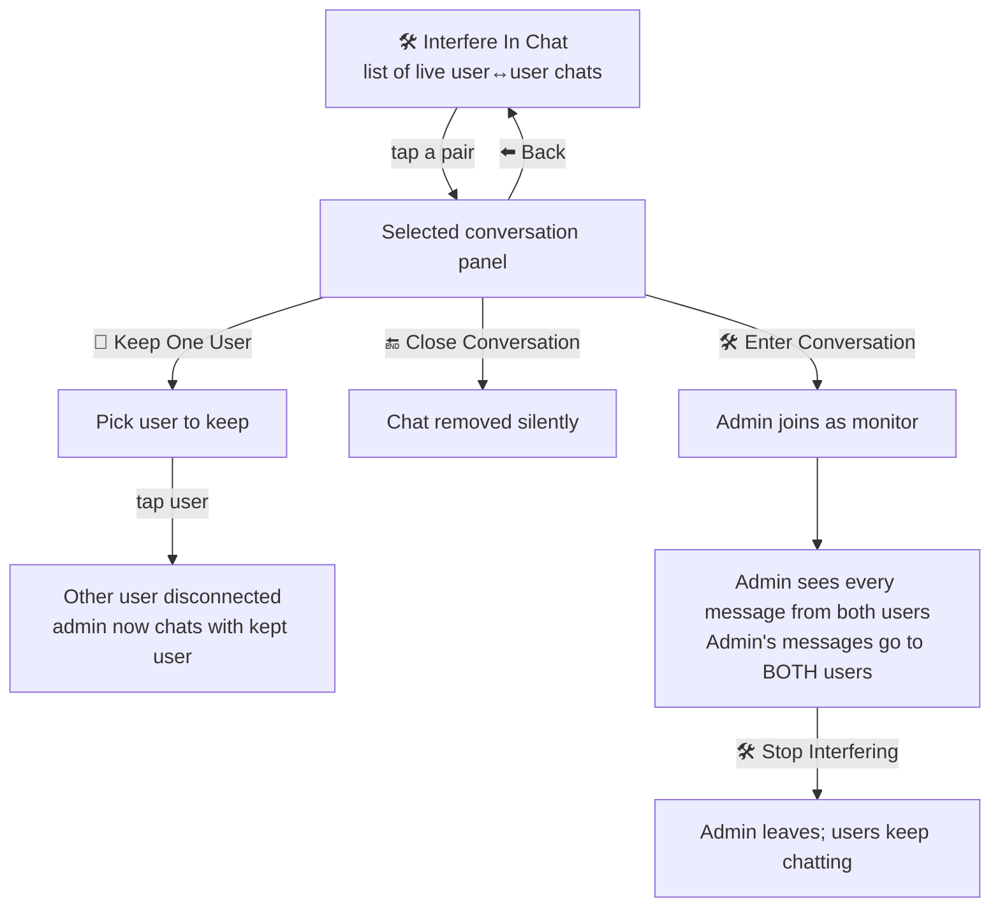
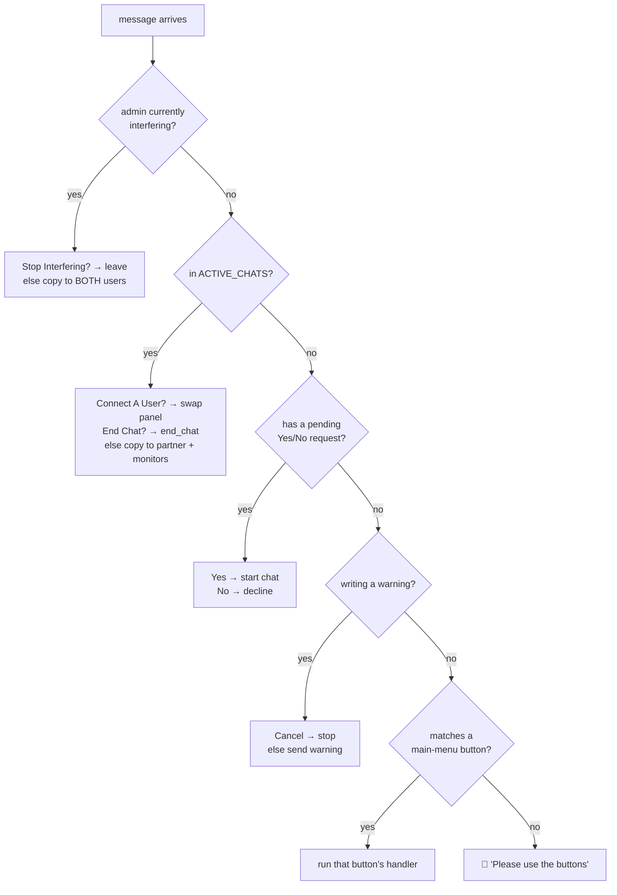

# Jamal Bot — Anonymous Chat Telegram Bot

A Telegram bot that connects users to each other **anonymously**, lets users **contact an admin**, and gives admins a **control panel** to manage users and **step into live conversations**.

Everything is bilingual (English / فارسی), every screen is a small "panel" with an animated title, and all data is stored in plain CSV files — no database needed.

---

## Table of contents

1. [Quick start](#1-quick-start)
2. [Where settings and credentials live](#2-where-settings-and-credentials-live)
3. [Project map](#3-project-map)
4. [Architecture — the big picture](#4-architecture--the-big-picture)
5. [Roles: user, admin, root admin](#5-roles-user-admin-root-admin)
6. [The panels (UI design)](#6-the-panels-ui-design)
7. [File-by-file walkthrough](#7-file-by-file-walkthrough)
8. [Feature flows, step by step](#8-feature-flows-step-by-step)
9. [How a message is routed (`handle_text`)](#9-how-a-message-is-routed-handle_text)
10. [Callback data cheat-sheet](#10-callback-data-cheat-sheet)
11. [Data files](#11-data-files)
12. [Limits and things to know](#12-limits-and-things-to-know)
13. [Running on a server](#13-running-on-a-server)

---

## 1. Quick start

You need **Python 3.10 – 3.12** (not 3.13: python-telegram-bot 13 uses a module that 3.13 removed).

```powershell
# 1. Create a virtual environment and install the libraries (once)
py -3.12 -m venv .venv
.venv\Scripts\python.exe -m pip install -r requirements.txt

# 2. Put your credentials in .env (once)
copy .env.example .env      # then open .env and paste your bot token

# 3. Run
python runner.py
```

`runner.py` automatically switches to `.venv`, checks the token is set, stops any old copy of the bot that is still running, and starts the bot. Logs print in the terminal. **Ctrl+C** stops it.

First time? Put your numeric Telegram ID in `OWNER_ID` in `.env` and you are admin from the start. (Don't know your ID? Start the bot, press **🆔 My ID**, paste it into `.env`, and restart.) Without `OWNER_ID`, press **👑 Claim Admin**: if no admin is configured yet, you become the admin.

---

## 2. Where settings and credentials live

| Setting | File | Who writes it | Meaning |
|---|---|---|---|
| `TOKEN` | `.env` | you | Bot token from [@BotFather](https://t.me/BotFather). **Secret.** |
| `ROOT_ADMINS` | `.env` | you | Comma-separated Telegram usernames (no `@`) of root admins. |
| `OWNER_ID` | `.env` | you | Your numeric Telegram ID. Always admin + root admin, can't be banned or removed. Comma-separate for several. |
| `ADMINS` | `profile.csv` | **the bot** | Comma-separated Telegram user IDs of admins. Changed by *Claim Admin*, *Add As Admin*, *Remove As Admin*. |

> **Why is `ADMINS` not in `.env`?** The bot edits the admin list itself while running. Settings are looked up in this order: **environment / `.env` → `profile.csv` → `requirements.txt`**, first non-empty value wins. If `ADMINS` were in `.env`, it would always win and the admin buttons would silently stop working.

`.env` is listed in `.gitignore`, so it never gets committed. `.env.example` is the safe template you can share.

---

## 3. Project map

```
sender-sample/
├── runner.py          ▶ Start here. Launches the bot.
├── simple_csv_bot.py  🧠 The whole bot: texts, panels, keyboards, handlers.
├── csv_runtime.py     ⚙️ Reads settings (.env → profile.csv), saves ADMINS.
├── user_store.py      👥 Everything about users.csv (register, ban, language, stats).
├── csv_storage.py     🗂 Creates csv_data/ and its empty tables on first run.
├── target_store.py    🗂 Creates target.csv on first run (legacy, see §11).
├── .env               🔑 Your credentials (secret, not committed).
├── .env.example       🔑 Template for .env.
├── profile.csv        ⚙️ Runtime settings the bot writes (ADMINS).
├── requirements.txt   📦 Python libraries.
└── csv_data/
    └── users.csv      👥 One row per person who ever used the bot.
```

---

## 4. Architecture — the big picture



Three ideas explain the whole design:

1. **Two kinds of storage.**
   - *Permanent* (survives restart): `users.csv` (who exists, language, banned, chat count) and `profile.csv` (admin IDs).
   - *Live* (lost on restart): Python dictionaries in `simple_csv_bot.py` that track who is chatting with whom right now.
2. **A chat is just two entries in a dictionary.** `ACTIVE_CHATS[a] = b` and `ACTIVE_CHATS[b] = a`. When `a` sends anything, the bot looks up `b` and copies the message there.
3. **Messages are *copied*, not *forwarded*.** `bot.copy_message` re-sends the content without the "Forwarded from …" header — that is what keeps anonymous chats anonymous.

---

## 5. Roles: user, admin, root admin

| Role | How you get it | What you can do |
|---|---|---|
| **User** | Send `/start` | Contact an admin, start an anonymous talk, change language. |
| **Admin** | Your ID is in `ADMINS` (`profile.csv`) | Everything a user sees, *except* anonymous talk, **plus** Status, Connect to User, User Manager (ban / unban / warn), User Lists, Interfere In Chat. |
| **Root admin** | Your **username** is in `ROOT_ADMINS` (`.env`) | Can **add and remove admins**. Can **never be banned** (the bot also un-bans root admins on every start). |
| **Owner** | Your **numeric ID** is in `OWNER_ID` (`.env`) | Admin + root admin automatically, no Claim Admin needed. Can't be banned, and the *Remove As Admin* button never appears for the owner. Unlike root admins, this is tied to your ID, so it keeps working if you change your username. |

**Owner in code:** `csv_runtime.get_admin_ids()` returns `ADMINS` from `profile.csv` **plus** `OWNER_ID`, so every admin check in the bot includes the owner. `is_root_admin()` returns true for the owner's ID before checking usernames.

**Bootstrap mode:** while `ADMINS` is empty (or the placeholder `1234`) **and no `OWNER_ID` is set**, *anyone* who presses **👑 Claim Admin** becomes an admin. As soon as one admin exists, Claim Admin replies "Admin is already configured."

> A root admin also needs to be in `ADMINS` to see the admin panel. "Root" adds powers on top of "admin"; it does not replace it.

---

## 6. The panels (UI design)

### 6.1 The panel format

Every message the bot sends goes through `format_panel(title, lines, hint)`:

```
👑 Admin Console 👑          ← title, wrapped in an emoji "frame"

Everything is ready...        ← body lines
Choose a button below.

↩️ Tap Cancel to stop.        ← optional hint
```

- **Title frames rotate.** `decorate_title` picks an emoji set by topic (admin 👑⚡🛠✨, chat 💬🗨️📨✨, warning ⚠️🚨🔥⚡, status 📊📈✨📉, welcome 🌈✨🌟🫧) and uses the next frame each time, so consecutive panels look alive.
- **Typing animation.** After sending, the bot edits the message a few times, adding `.` `..` `...` to the last line (every 0.18 s) — a small "typing" effect. Done by `schedule_response_animation` via the JobQueue.
- **Safety net.** `ensure_panel_text` wraps any plain string that isn't already a panel into a "🙂 Friendly Reminder" panel, so the look stays consistent.

### 6.2 The main keyboards (bottom of the screen)

These are `ReplyKeyboardMarkup` — big buttons that replace the phone keyboard. Built by `get_main_keyboard(user_id)`.

**Normal user**
```
┌──────────────────────┬──────────────────────────┐
│ 🆔 My ID             │ 👑 Claim Admin           │
├──────────────────────┼──────────────────────────┤
│ 💬 Contact with Admin│ 🎭 Start Anonymous Talk  │
├──────────────────────┼──────────────────────────┤
│ ❓ Help              │ 🇮🇷 Farsi                │
└──────────────────────┴──────────────────────────┘
```

**Admin**
```
┌──────────────────────┬──────────────────────────┐
│ 🆔 My ID             │ 👑 Claim Admin           │
├──────────────────────┼──────────────────────────┤
│ 📊 Status            │ 🔗 Connect to User       │
├──────────────────────┼──────────────────────────┤
│ ➕ Add Target        │ 👥 User Lists            │
├──────────────────────┴──────────────────────────┤
│ 🛠 Interfere In Chat                            │
├──────────────────────┬──────────────────────────┤
│ ❓ Help              │ 🇮🇷 Farsi                │
└──────────────────────┴──────────────────────────┘
```

**While in a chat** (`get_chat_keyboard`)
```
User:                         Admin:
┌──────────────┐              ┌──────────────────────────────────┐
│ 🔚 End Chat  │              │ ➕ Connect A User To This Chat   │
└──────────────┘              ├──────────────────────────────────┤
                              │ 🔚 End Chat                      │
                              └──────────────────────────────────┘
```

**Other temporary keyboards**
```
Yes/No decision:   [ ✅ Yes ] [ ❌ No ]          (get_target_decision_keyboard)
Writing a warning: [ ↩️ Cancel ]                 (get_warning_keyboard)
Interfering:       [ 🛠 Stop Interfering ]       (build_interfere_chat_keyboard)
```

### 6.3 Inline panels (buttons inside a message)

These are `InlineKeyboardMarkup` — buttons attached to a message. Pressing one sends a hidden **callback** string (see §10) and the bot usually *edits the same message* to show the next screen, so the panel feels like an app page.

**User Manager** (➕ Add Target)
```
🛠 User Manager 🛠
Selected user: @someone
Admin: Off | Ban: Off
┌─────────────────────────┐
│ 🚫 Ban User             │   ← or ✅ Remove From Ban
│ 👑 Add As Admin         │   ← root admins only (or ➖ Remove As Admin)
│ ⚠️ Send Warning         │
│ ⬅️ Back to Users        │
└─────────────────────────┘
```

**Interfere In Chat**
```
🛠 Interfere In Chat 🛠                  🛠 Interfere In Chat 🛠
Choose one live conversation...          Selected conversation: @a <-> @b
┌────────────────────────┐               ┌──────────────────────────┐
│ 💬 @a <-> @b           │  ── tap ──▶   │ 🛠 Enter Conversation    │
│ 💬 @c <-> @d           │               │ 🔚 Close Conversation    │
└────────────────────────┘               │ 👤 Keep One User         │
                                         │ ⬅️ Back to Users         │
                                         └──────────────────────────┘
```

**Anonymous request** (what receivers see)
```
🎭 Anonymous Request 🎭
Someone wants an anonymous chat.
Accept or reject below before this request expires. ..
[ ✅ Yes ] [ ❌ No ]
```

### 6.4 Language

All text lives in one dictionary, `TEXT = {"en": {...}, "fa": {...}}`. Code never writes a sentence directly; it calls `t(lang, "key", name=value)`. The **🇮🇷 Farsi / 🇬🇧 English** button flips the user's language, saved in `users.csv`.

Because a button press arrives as plain text, `is_button_text(text, key)` accepts the label in **either** language — so the keyboard keeps working even if the user switched language mid-conversation.

---

## 7. File-by-file walkthrough

### 7.1 `runner.py` — the launcher

```text
1. Is there a .venv?  → re-run this same script with .venv's Python
2. import psutil + get_setting  (only possible inside .venv)
3. TOKEN missing?     → print how to fix, exit
4. stop_existing()    → find any running "python simple_csv_bot.py" and terminate it
5. start simple_csv_bot.py and wait (Ctrl+C stops it)
```

Step 4 matters: Telegram allows **only one** process to poll a bot. Two copies would fight with `Conflict: terminated by other getUpdates request`.

### 7.2 `csv_runtime.py` — settings

| Function | What it does |
|---|---|
| `load_dotenv(.env)` | At import, copies `.env` values into environment variables. |
| `get_setting(name, default)` | Looks in environment → `profile.csv` → `requirements.txt` (lines like `KEY=value`), returns the first non-empty value. |
| `get_required_setting(name)` | Same, but raises an error if missing. Used for `TOKEN`. |
| `get_owner_ids()` | Parses `OWNER_ID` from `.env` into a list of ints. |
| `get_admin_ids()` | Parses `ADMINS` (`"111,222"`) into `[111, 222]` and adds the owner ID(s). |
| `is_bootstrap_admin_mode()` | True when `ADMINS` is empty or `1234` **and** no `OWNER_ID` → Claim Admin is open. |
| `set_profile_setting(name, value)` | Rewrites one row of `profile.csv`, keeping the others. This is how the admin list is saved. |
| `get_storage_mode()` | Returns `STORAGE_MODE` (default `csv`). Not used by the bot today. |

### 7.3 `csv_storage.py` — table layout

Holds `TABLE_SCHEMAS`: the column names of each CSV table. `ensure_storage_layout()` creates `csv_data/` and writes a header-only file for any table that doesn't exist yet. Called at startup and before every read/write of `users.csv`.

> Only **`users`** is used by this bot. The other tables (`orders`, `mbots`, `apis`, …) are left over from the earlier "sender" project this bot grew out of. They are harmless.

### 7.4 `user_store.py` — the users table

Every function **reads the whole `users.csv`, changes it in memory, writes it all back**. Simple and fine for hundreds of users.

`users.csv` columns: `id, user_id, username, first_name, language, chat_count, is_banned, status, step, created_at, uniq_id`.

| Function | What it does |
|---|---|
| `register_user(id, username, first_name)` | Adds a new row, or refreshes username/name of an existing one. Called on **every** update via `ensure_registered`, so the list is always current. |
| `get_user_by_id`, `get_users_by_ids`, `get_all_users` | Lookups. |
| `get_active_users(admin_ids)` | All users that are not admins (for *Connect to User*). |
| `get_user_language` / `set_user_language` | `en` or `fa`. |
| `is_user_banned` / `set_user_banned` | The `is_banned` flag (`"1"` / `"0"`). |
| `increment_chat_count` | +1 each time a user joins a chat (shown in Status). |
| `get_display_name(row, include_id)` | `@username`, else first name, else `Unknown`; optionally `| id: 123`. |
| `get_user_list_text` | The text for **👥 User Lists** (first 50 users). |
| `get_chat_status_text` | The text for **📊 Status**: total users, admins, banned, total chats. |

### 7.5 `target_store.py`

Creates `target.csv` with its header if missing. Legacy from the sender project; the bot calls it at startup but doesn't use the data.

### 7.6 `simple_csv_bot.py` — the bot, section by section

The file reads top to bottom in this order:

**① Setup and global state (top of file)**

```python
ADMIN_IDS = get_admin_ids()                 # [int, ...] from profile.csv
TOKEN = get_required_setting("TOKEN")       # from .env
ROOT_ADMIN_USERNAMES = {...}                # from ROOT_ADMINS in .env

PENDING_REQUESTS = {}        # "requester:target" -> direct chat request waiting for Yes/No
ANONYMOUS_REQUESTS = {}      # "anon_<id>"        -> anonymous request broadcast to many users
ACTIVE_CHATS = {}            # user_id -> partner_id   (always stored both ways)
CHAT_MONITORS = {}           # (a, b) sorted pair -> {admin_ids watching/interfering}
ACTIVE_INTERFERING_ADMINS = {}   # admin_id -> (a, b) pair they are inside
BOT_JOB_QUEUE = None         # set in main(), used for animations
```

**② Texts** — the big `TEXT` dictionary plus helpers `t()`, `button()`, `get_lang()`, `is_button_text()`.

**③ Role helpers**

- `is_admin(id)` → `id in ADMIN_IDS`.
- `set_admin_status(id, on/off)` → edits the list → `save_admin_ids` → writes `profile.csv` → `refresh_admin_ids` reloads it.
- `is_root_admin(user_id, telegram_user)` → compares the **username** (from Telegram or `users.csv`) with `ROOT_ADMIN_USERNAMES`.
- `is_effectively_banned(id)` → banned **and** not root.
- `ensure_root_admin_unbanned()` → runs at startup, clears any ban on a root admin.

**④ "Is this person busy?" helpers**

- `has_direct_pending_request(id)` — waiting on / waiting for a Yes/No request.
- `has_anonymous_pending_request(id)` — sent an anonymous request, or received one that is still open.
- `get_available_anonymous_users(id)` — everyone except the requester, admins and banned users.
- `get_connectable_chat_users(admin, partner)` — users an admin can swap into their chat: not admin, not banned, not busy.

**⑤ Interfere helpers**

- `get_chat_pair_key(a, b)` → `(min, max)`, so `a↔b` and `b↔a` are the same key.
- `get_interferable_chat_pairs()` — every live chat where neither side is an admin.
- `clear_admin_interference(admin)` / `clear_chat_monitors(a, b)` — cleanup when an admin leaves or the chat ends.

**⑥ Keyboards and inline panels** — `get_main_keyboard`, `get_chat_keyboard`, `get_target_decision_keyboard`, `get_warning_keyboard`, `build_interfere_*`, `build_keep_user_markup`, `build_manage_*`, `build_connect_chat_user_markup`. (Pictured in §6.)

**⑦ Panel rendering and animation** — `format_panel`, `decorate_title`, `ensure_panel_text`, `append_animation_suffix`, `schedule_response_animation`, and three senders that combine them:

| Sender | Use |
|---|---|
| `reply_animated_text(message, text, markup)` | Reply to the message the user just sent. |
| `send_animated_text(bot, chat_id, text, markup)` | Send to any user (e.g. the other side of a chat). |
| `edit_animated_text(bot, chat_id, msg_id, text, markup)` | Replace an existing panel (inline navigation). |
| `reply_with_menu` / `send_menu_message` | Same, but always attach the main keyboard. |

**⑧ Command handlers** — `start`, `help_command`, `myid_command`, `claimadmin_command`, `status`, `start_connect_user`, `start_contact_admin`, `start_anonymous_talk`, `render_manage_users`, `user_lists_command`, `switch_language`, `start_interfere_chat`.

**⑨ Jobs (timers)** — `pending_animation_job`, `pending_timeout_job`, `anonymous_pending_animation_job`, `anonymous_timeout_job`, `animate_response_job`.

**⑩ Callback handlers** — one per panel family: `connect_user_callback`, `anonymous_reply_callback`, `interfere_chat_callback`, `manage_user_callback`, `admin_chat_callback`.

**⑪ `handle_text`** — the router for everything typed or tapped on the reply keyboard (see §9).

**⑫ `main()`** — creates storage, un-bans root admins, builds the `Updater`, registers all handlers, starts polling:

```python
CommandHandler("start" | "help" | "myid" | "claimadmin" | "status" |
               "connectuser" | "contactadmin" | "addtarget" | "userlists")
CallbackQueryHandler(..., pattern="^admin_chat:")
CallbackQueryHandler(..., pattern="^anonymous_reply:")
CallbackQueryHandler(..., pattern="^interfere_chat:")
CallbackQueryHandler(..., pattern="^manage_user:")
CallbackQueryHandler(..., pattern="^request_chat:(user|admin):")
MessageHandler(all non-commands -> handle_text)
MessageHandler(unknown commands -> unknown)
```

---

## 8. Feature flows, step by step

### 8.1 🎭 Anonymous Talk — "first to accept wins"



- If **everyone rejects**, or **45 s pass** with no accept, A sees "Nobody accepted", receivers see "expired".
- **Admins cannot** start anonymous talks (they use *Connect to User*), and admins never receive anonymous requests.
- Code: `start_anonymous_talk` → `anonymous_reply_callback` → `anonymous_timeout_job`.

### 8.2 💬 Contact with Admin / 🔗 Connect to User — direct request

Same mechanism both ways: a user picks an admin, or an admin picks a user.



- When an **admin** asks, the target sees "An admin wants to talk to you privately". When a **user** asks, the admin sees the user's name.
- The target's Yes/No arrives as text, so it is handled inside `handle_text` (not a callback).
- Code: `start_contact_admin` / `start_connect_user` → `connect_user_callback` → `handle_text` (Yes/No) → `pending_timeout_job`.

### 8.3 🔚 Ending a chat

Either side taps **🔚 End Chat** → `end_chat()` removes both entries from `ACTIVE_CHATS`, removes any monitoring admins, and sends everyone "🔚 Conversation Ended" with their main keyboard back.

### 8.4 🛠 Interfere In Chat — the admin control room



How each action works in code (`interfere_chat_callback`):

| Action | What changes |
|---|---|
| **Enter** (`join`) | Adds the admin to `CHAT_MONITORS[(a,b)]` and `ACTIVE_INTERFERING_ADMINS[admin]`. From now on, `handle_text` copies each user message to the monitors too, and copies the admin's messages to both users. |
| **Close** (`close`) | `close_chat_silently(a, b)` — removes the chat. The two users are not notified. |
| **Keep One User** (`keep`) | Closes `a↔b`, then sets `ACTIVE_CHATS[admin] = kept`, `ACTIVE_CHATS[kept] = admin`. The admin takes over the conversation. |
| **Stop Interfering** | `clear_admin_interference(admin)` — admin leaves, users continue. |

Only chats between **two non-admins** appear in the list.

### 8.5 ➕ Connect A User To This Chat — admin swaps partner

While an admin is in a chat, their keyboard has **➕ Connect A User To This Chat**. It lists free users (`get_connectable_chat_users`). Tapping one (`admin_chat:swap:<old>:<new>`) closes the current chat and connects the admin to the new user. Code: `admin_chat_callback`.

### 8.6 ➕ Add Target — the User Manager

Despite its name, **➕ Add Target** (and `/addtarget`) opens the **User Manager**: a list of up to 30 users → tap one → action panel.

| Button | Who can use it | Effect |
|---|---|---|
| 🚫 Ban User / ✅ Remove From Ban | any admin (never on a root admin) | Sets `is_banned` in `users.csv`. Banned users can't start or receive any connection. |
| 👑 Add As Admin / ➖ Remove As Admin | **root admins only** | Edits `ADMINS` in `profile.csv`, applied immediately. |
| ⚠️ Send Warning | any admin | Bot asks you to type a message; it is delivered to the user as "⚠️ Warning from Jamal Bot". The pending state is kept in `context.user_data["awaiting_warning_target_id"]`. |

Code: `render_manage_users` → `render_manage_actions` → `manage_user_callback` → (warning text) `handle_text`.

### 8.7 Small buttons

| Button | Handler | Does |
|---|---|---|
| 🆔 My ID | `myid_command` | Shows your numeric Telegram ID. |
| 👑 Claim Admin | `claimadmin_command` | Makes you admin if bootstrap mode is on (§5). |
| 📊 Status | `status` | Users / admins / banned / total chats. |
| 👥 User Lists | `user_lists_command` | First 50 users with IDs. |
| ❓ Help | `help_command` | Same as `/start`. |
| 🇮🇷 Farsi / 🇬🇧 English | `switch_language` | Flips language. |

---

## 9. How a message is routed (`handle_text`)

Every non-command message goes through these checks **in order**; the first match handles it:



Because chat relaying is checked **before** the menu, anything a user types during a chat — including text that looks like a button — goes to their partner. Only **🔚 End Chat** (and the admin's connect button) are intercepted.

`MessageHandler(Filters.all & ~Filters.command)` means photos, voice notes, stickers and files are relayed too, since `copy_message` works for any content type.

---

## 10. Callback data cheat-sheet

Inline buttons carry a short string. The prefix picks the handler, the rest are `:`-separated arguments.

| Callback data | Handler | Meaning |
|---|---|---|
| `request_chat:admin:<target>` | `connect_user_callback` | User asks admin `<target>` to chat. |
| `request_chat:user:<target>` | `connect_user_callback` | Admin asks user `<target>` to chat. |
| `anonymous_reply:accept:anon_<requester>` | `anonymous_reply_callback` | Accept anonymous request. |
| `anonymous_reply:reject:anon_<requester>` | `anonymous_reply_callback` | Reject it. |
| `interfere_chat:list` | `interfere_chat_callback` | Back to list of live chats. |
| `interfere_chat:select:<a>:<b>` | ″ | Show actions for chat a↔b. |
| `interfere_chat:join:<a>:<b>` | ″ | Enter the chat. |
| `interfere_chat:close:<a>:<b>` | ″ | Close the chat. |
| `interfere_chat:keep_menu:<a>:<b>` | ″ | Choose who to keep. |
| `interfere_chat:keep:<a>:<b>:<kept>` | ″ | Keep `<kept>`, drop the other. |
| `manage_user:list` | `manage_user_callback` | Back to user list. |
| `manage_user:select:<id>` | ″ | Open a user's action panel. |
| `manage_user:action:<ban\|unban\|add_admin\|remove_admin\|warn>:<id>` | ″ | Do the action. |
| `admin_chat:swap:<current>:<new>` | `admin_chat_callback` | Admin swaps chat partner. |

Every callback handler **re-checks permissions** (`is_admin`, `is_root_admin`), so a forged button can't bypass them.

---

## 11. Data files

| File | Used? | Contents |
|---|---|---|
| `csv_data/users.csv` | ✅ | Every user: ID, username, name, language, chat count, banned flag. |
| `profile.csv` | ✅ | `ADMINS` (written by the bot). |
| `.env` | ✅ | `TOKEN`, `ROOT_ADMINS`, `OWNER_ID`. |
| `csv_data/*.csv` (others) | ❌ | Legacy tables from the earlier sender project; created automatically, ignored. |
| `target.csv` | ❌ | Legacy; created at startup, not read. |
| `.dbg/` | ❌ | Leftover from a debugging session; safe to delete. |

---

## 12. Limits and things to know

- **Live chats are lost on restart.** `ACTIVE_CHATS`, pending and anonymous requests live in memory. Users and admins are permanent; open conversations are not.
- **One process only.** Telegram lets one process poll a bot at a time. `runner.py` kills an older local copy, but not a copy running on another machine — stop the server copy before testing locally.
- **CSV is re-read on every update.** Fine for hundreds of users; move `users.csv` to SQLite if it grows to many thousands.
- **Root admins are matched by username.** If a root admin changes their Telegram username, update `ROOT_ADMINS` in `.env`.
- **Library versions are pinned** to python-telegram-bot **13.15** (the bot uses the v13 API: `Updater`, `Filters`, `use_context=True`). Don't upgrade it to v20+ without rewriting the handlers.

---

## 13. Running on a server

Linux example:

```bash
python3.12 -m venv .venv
.venv/bin/pip install -r requirements.txt
cp .env.example .env && nano .env        # paste token
nohup python3 runner.py > bot.log 2>&1 &  # keeps running after you log out
tail -f bot.log                           # watch logs
```

Running `runner.py` again restarts the bot (it stops the old copy first).
